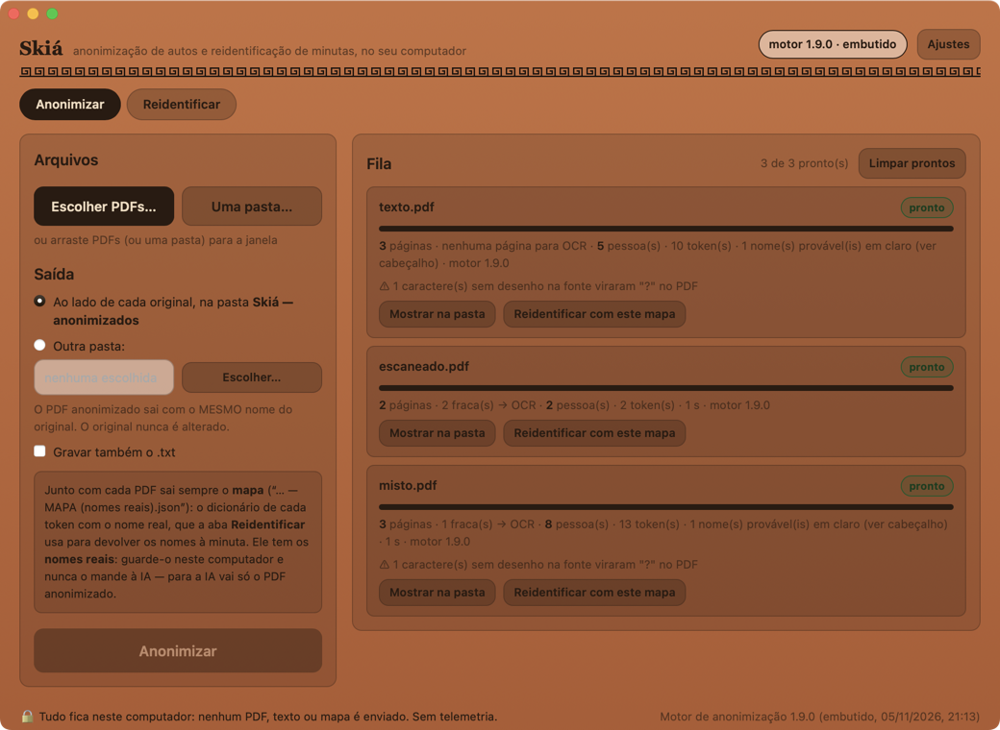
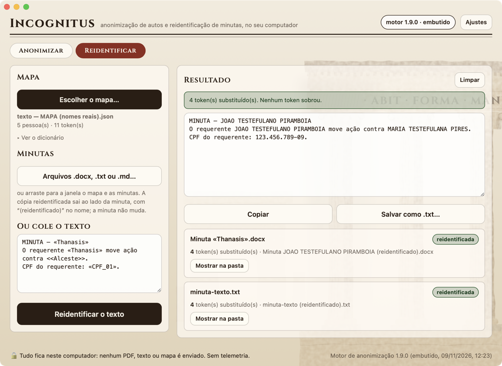

# Incognitus

*Incognitus: em latim, "não reconhecido". A pessoa continua nos autos, só não é reconhecida — o nome sai, a forma fica.*



Aplicativo de computador (Mac e Windows) que **anonimiza autos em PDF, em lote**, com o **mesmo motor de anonimização
do Graphé** — o mesmo fluxo do lote automático (preparar → classificador bayesiano → concluir), as mesmas regras, o
mesmo cabeçalho de autos anonimizados — e **reidentifica as minutas** que a IA devolve, com o mapa de cada processo,
como o 🔓 do Graphé. **Tudo roda no computador**: nenhum PDF, texto ou mapa sai dele, e não há telemetria. A única
conexão é a checagem das regras (só leitura de um repositório público), que os Ajustes desligam.


## Como usar

### Anonimizar

1. **Escolher PDFs…** (vários de uma vez), **Uma pasta…**, ou arrastar PDFs/pastas para a janela.
2. **Saída**: por padrão, ao lado de cada original, na pasta **`Incognitus — anonimizados`**; ou outra pasta à escolha.
   O PDF anonimizado sai com o **mesmo nome** do original. O original **nunca** é aberto para escrita: as ferramentas
   trabalham numa cópia temporária, e o Incognitus recusa gravar por cima dele.
3. Opcional: **Gravar também o .txt** (o mesmo texto do Graphé: cabeçalho + `===== PÁGINA n =====`).
4. **Anonimizar**. Um PDF por vez; a fila mostra cada etapa (extraindo, OCR x/y, anonimizando, gravando, pronto, erro).
   No máximo 2 OCRs ao mesmo tempo, com prioridade baixa. A pasta temporária de cada PDF é apagada ao fim dele.

**A saída**: os **autos anonimizados** e o **mapa**, lado a lado.

- O PDF tem a primeira folha para o cabeçalho de autos anonimizados (com a versão do motor) e **uma folha para cada
  página dos autos**, em fonte monoespaçada (DejaVu Sans Mono) de **11 pt** — a fonte nunca encolhe: a folha cresce
  quando a página tem linhas longas. O texto é selecionável (dá para copiar e mandar a uma IA).
- O mapa, `… — MAPA (nomes reais).json`, sai **sempre** (pedido do Promotor, 05/11/2026): o dicionário de cada token
  («Thanasis», «REU_01», «CPF_01»…) com o nome ou o dado real, no mesmo formato do mapa do Graphé. É ele que devolve
  os nomes na reidentificação. Tem os **nomes reais**: fica no computador e nunca vai à IA — para a IA vai só o PDF.
- **Os carimbos do PJe** (pedido do Promotor, 09/11/2026) saem **sem quem assina e sem quem gerou o PDF**:
  "Assinado eletronicamente por: [omitido] - 05/11/2026 14:32:10", "Este documento foi gerado pelo usuário [omitido]
  em …"; o pedaço do carimbo que o pdftotext parte em linhas na diagonal some. Também os carimbos do SEI ("documento
  assinado eletronicamente por [omitido], Promotora de Justiça, …") e da assinatura ICP-Brasil (o CPF junto). Ficam a
  data, a hora, o número do documento e o "Num. … - Pág.", que a IA usa para citar o ID. No corpo dos autos vale a
  regra do Graphé: servidores, autoridades e advogados ficam em claro.

### Reidentificar



A aba **Reidentificar** faz o que o 🔓 do Graphé faz na minuta, com as mesmas funções do motor:

1. **Escolher o mapa…** (ou, na fila, **Reidentificar com este mapa**). O mapa do Graphé também serve. O dicionário
   (token → nome) fica à vista em **Ver o dicionário**.
2. A minuta que a IA devolveu: **arquivos .docx, .txt ou .md** (ou arrastados para a janela, junto com o mapa), ou o
   texto **colado** na caixa.
3. Cada token do mapa volta a ser o nome — aceitando os delimitadores que a IA tenha trocado (`«»`, `<<>>`, `[[]]`,
   `{{}}`); o nome grego só é trocado com delimitador (um "Sócrates" solto pode ser o filósofo). O nome do arquivo
   também é reidentificado.
4. O **aviso** aponta o que sobrou: token fora do mapa, malformado ou que ficou. Confira esses pontos antes de usar.

O arquivo reidentificado sai **ao lado da minuta**, com `(reidentificado)` no nome; a minuta não muda. No .docx, a
troca é feita dentro de cada parágrafo (mesmo com o token partido em trechos de formatação diferentes, como o Word às
vezes grava), no corpo, nos cabeçalhos, nos rodapés, nas notas e nos comentários; o resto do arquivo sai igual. O texto
colado volta na tela, com **Copiar** e **Salvar como .txt…**.

**Ajustes**: os **contatos institucionais** que ficam em claro (um por linha; o padrão é o `ANON_INST_PADRAO` do
Graphé), a checagem das regras ao abrir, a versão do motor em uso, **Atualizar regras** e **Voltar à versão anterior**.

## Como abrir (o app ainda não tem assinatura digital)

- **Mac**: abra o `.dmg`, arraste o Incognitus para Aplicativos. Na primeira vez, o macOS avisa que não pode verificar o
  desenvolvedor: clique em **OK**, abra **Ajustes do Sistema → Privacidade e Segurança**, role até "O Incognitus foi
  bloqueado…" e clique em **Abrir Mesmo Assim** (pede a senha). Se aparecer "está danificado", rode uma vez no Terminal:
  `xattr -dr com.apple.quarantine /Applications/Incognitus.app`.
- **Windows**: rode o `.msi`. Se o SmartScreen avisar "O Windows protegeu o computador", clique em **Mais informações →
  Executar assim mesmo**. (Se o navegador bloquear o download, escolha "Manter".)

## O motor (as regras)

`motor/motor.js` é gerado por **`scripts/extrair_motor.mjs`** a partir do `graphe.js` (pasta irmã `../Graphe`):

- tira **só** o que o app usa — as funções que o `testes/anon/pipeline.js` do Graphé chama, mais o cabeçalho do
  `anonConcluir`, a escolha das páginas para o OCR e a reidentificação do 🔓 (`_anonReidentificarTexto_`,
  `_anonReidTitulo_`, `_anonSobrasReid_`) — e, **pelo nome** (nunca por número de linha), tudo de que elas dependem
  (355 declarações na 1.9.0). O `pipeline.js` vai junto, sem alteração;
- o que no Graphé vem da planilha e do Apps Script (VARIAVEIS_GLOBAIS, equipe, propriedades, Logger) é o
  `motor/fonte/ambiente.js`: equipe vazia, contatos institucionais pelos Ajustes. A API do app é `motor/fonte/api.js`
  (versão 2, a da reidentificação: o app só aceita motor da sua versão de API);
- os comentários saem (o motor vai para um repositório público e eles citam casos);
- **trava** (`scripts/trava.mjs`): o build **para** se o motor tiver ID de arquivo do Drive, URL de WebApp, ID de
  planilha, token ou chave, e-mail, prompt de IA, código do Apps Script ou nome de pessoa — e lista o que achou. Nomes
  só podem estar nas listas de palavras do motor (léxicos do IBGE, municípios, prenomes gregos), na lista de
  autoridades públicas que o motor deixa em claro (`ANON_LISTA_BRANCA_FIXA`) e nos contatos institucionais;
- **suíte** (`scripts/regressao_motor.cjs`): o `testes/anon/regressao.js` do Graphé (63 casos fictícios), **sem
  alteração**, rodando sobre o `motor.js` num contexto limpo, sem nada do Apps Script; depois os mesmos casos pela
  API do Incognitus — cada um com a **volta**: os autos anonimizados, reidentificados com o próprio mapa, não podem guardar
  token nem sobra —, e a paridade caso a caso com o `pipeline.js`. Só aceita o motor com **"0 falhas"** e **63/63**.

```bash
node scripts/extrair_motor.mjs            # monta motor/ e o motor embutido no app (src/motor/)
node scripts/regressao_motor.cjs          # só a suíte
```

### Atualização das regras pelo GitHub

O app baixa as regras de um repositório **público** só com o motor (`claudiogonzaga/incognitus-motor`, ainda **não
criado** — ver Pendências): `motor.js`, `manifesto.json` (versão = `ANON_VERSAO`, data, sha256) e
`manifesto.json.sig` (Ed25519). Ao abrir (se ligado nos Ajustes) e no botão **Atualizar regras**: baixa o manifesto,
**confere a assinatura** com a chave pública embutida no app (`motor/chave_publica.txt`), compara a versão, baixa o
`motor.js`, **confere o sha256**, **roda os 63 casos embutidos** num worker à parte e só então troca. A versão
anterior fica guardada (**Voltar à versão anterior**). Assinatura adulterada, sha256 errado ou caso falhando: nada muda.

```bash
scripts/publicar_motor.sh                 # extrai → suíte → casos do app → assina → commit + tag + release
scripts/publicar_motor.sh --sem-publicar  # tudo menos a publicação
```

A chave privada fica em `_segredo/motor_ed25519.pem` (fora do git, permissão 600, nunca impressa). **Faça uma cópia de
segurança dela**: sem ela, só um app novo (com outra chave pública) aceitaria regras novas.

## As ferramentas embutidas (sidecars)

`pdftotext` e `pdftoppm` (poppler) e `tesseract` com o modelo `por`, chamados **como o serviço do Graphé**
(`cloudrun-pdftotext/main.py`): `pdftotext -layout arquivo -` (um `\f` por página); páginas fracas pelo critério do
Graphé (`_pdfPaginasFracas_`); cada uma, `pdftoppm -r 200 -gray` + `tesseract -l por`; o texto do OCR só entra se tiver
mais texto útil (critério do serviço, com a semântica do Python: quebras de linha, `\d`/`\s` Unicode, `rstrip`).

Versões, para bater com o serviço (que roda em `python:3.11-slim`, Debian 13): **poppler 25.02.0** (o mais próximo do
25.03 do Debian publicado no conda-forge), **tesseract 5.5.0** e o `por.traineddata` do **tessdata_fast 4.1.0** — o
mesmo arquivo do pacote `tesseract-ocr-por` do Debian (sha256 `c4932b93…`, conferido).

```bash
python3 scripts/sidecars.py mac        # Mac: arm64 + x86_64 → universais (conda-forge via micromamba)
python scripts/sidecars.py windows     # Windows x64 (pip install pefile)
```

Licenças: o poppler é **GPL**; o tesseract, Apache-2.0. Os textos das licenças de todos os pacotes embutidos, as
versões e onde está o código-fonte vão dentro do app (`LICENCAS-terceiros/LEIA-ME.txt`). O workflow anexa o código-fonte
do poppler aos instaladores. A fonte do PDF é a DejaVu Sans Mono (licença livre, `recursos/fontes/LICENSE_DEJAVU`).

## Desenvolvimento

```bash
npm ci
python3 scripts/sidecars.py mac                              # uma vez (fica em .ferramentas/, fora do git)
npx tauri dev                                                # o app
npx tauri build --target universal-apple-darwin --bundles dmg
cargo test --manifest-path src-tauri/Cargo.toml              # PDF, assinatura, versões, .docx da reidentificação
python3 testes/e2e.py                                        # ponta a ponta (depois de: npx tauri build --debug --no-bundle)
python3 scripts/icone/gerar_icone.py && npx tauri icon scripts/icone/icone.png   # o ícone (depois: rm -r src-tauri/icons/{android,ios})
```

O **teste de ponta a ponta** gera 3 PDFs **fictícios** (texto, escaneado, misto), roda o app de verdade (modo de teste,
`SKIA_E2E`, com dados e cache à parte) e confere: nomes de saída iguais aos de entrada, nenhum dado de pessoa fictícia
em claro, originais intactos, uma folha por página + cabeçalho, 11 pt, o mapa ao lado; a **reidentificação** com o mapa
que o app gravou (texto colado, minuta .txt e .docx com um token partido em dois trechos de formatação, no corpo, no
cabeçalho e no nome do arquivo); a atualização assinada das regras (e a recusa da adulterada); e a **extração idêntica,
byte a byte, à do `main.py` do serviço** rodando localmente com as mesmas ferramentas.

**Build e entrega**: `.github/workflows/build.yml` (Actions → build → Run workflow, ou tag `v*`): macOS universal (`.dmg`)
e Windows x64 (`.msi`), como artefatos; com tag, também numa Release em rascunho.

Nunca use dados reais de processos em testes, exemplos, commits ou logs.

## Pendências (09/11/2026)

- **Repositório público das regras** (`claudiogonzaga/incognitus-motor`): não criado — espera a confirmação do Promotor, porque o
  código das regras fica visível a qualquer pessoa. Depois: `gh repo create claudiogonzaga/incognitus-motor --public` e
  `scripts/publicar_motor.sh`. Até lá, o app usa o motor embutido e a checagem ao abrir só não acha nada.
- **Assinatura digital**: sem Developer ID da Apple nem certificado de código para Windows, ficam os avisos do Gatekeeper
  e do SmartScreen (ver "Como abrir"). Ao assinar e notarizar no Mac, religar o *hardened runtime* exige também assinar
  as dylibs dos sidecars com a mesma equipe (ou o direito `com.apple.security.cs.disable-library-validation`).
- **Licença** do próprio Incognitus e do motor publicado: não definida.
- **Achado no motor do Graphé** (09/11/2026, com texto fictício): quando o vocativo da petição termina em "JUIZ DE
  DIREITO" ("EXCELENTÍSSIMO SENHOR JUIZ DE DIREITO", mesmo com linha em branco antes do parágrafo seguinte), o nome
  que abre o parágrafo seguinte fica **em claro** — a regra das autoridades (`ANON_RE_AUTORIDADE_ANTES`) o lê como o
  nome do juiz. Com a vara depois ("…JUIZ DE DIREITO DA 1ª VARA…") a parte vira token. A correção é no `graphe.js`;
  depois, `node scripts/extrair_motor.mjs` traz para cá.
- **Nome**: o app se chamava Skiá até a 0.2.0. O repositório (`claudiogonzaga/skia`) e a pasta (`CODIGO/Skia`) ainda
  têm o nome antigo; as variáveis de teste (`SKIA_E2E`, `SKIA_DADOS`…) e a API do motor (`SkiaMotor`) também, de
  propósito (são internas).
- **Ícone** (06/11/2026, a pedido do Promotor): uma mão grega faz sombra sobre a inscrição de uma coluna jônica, e a
  sombra esconde o meio das linhas; moldura de meandro do Phylax. Gerado por `scripts/icone/gerar_icone.py` (SVG → PNG
  pelo `rsvg-convert`).
- No Windows, o teste de ponta a ponta roda no CI (instalando o `.msi`); a instalação de um motor assinado só é testada
  onde está a chave privada (aqui), lá só a recusa de assinatura inválida.

## Estrutura

```
motor/            motor.js (gerado), manifesto + assinatura, casos.json, chave_publica.txt; fonte/: ambiente.js e api.js
src/              a janela (HTML/JS/CSS simples), worker.js (o motor no Web Worker), casos.js, motor/ (o embutido)
src-tauri/        Rust: sidecars (ferramentas.rs), PDF de saída (pdf.rs), motor e atualização (motor.rs), minutas da
                  reidentificação: .txt e .docx (reid.rs), comandos (lib.rs)
scripts/          extrair_motor.mjs, trava.mjs, regressao_motor.cjs, assinar_motor.mjs, publicar_motor.sh, sidecars.py,
                  icone/gerar_icone.py
testes/           gerar_pdfs.py (PDFs fictícios) e e2e.py
_segredo/         a chave privada do motor (fora do git)
```
