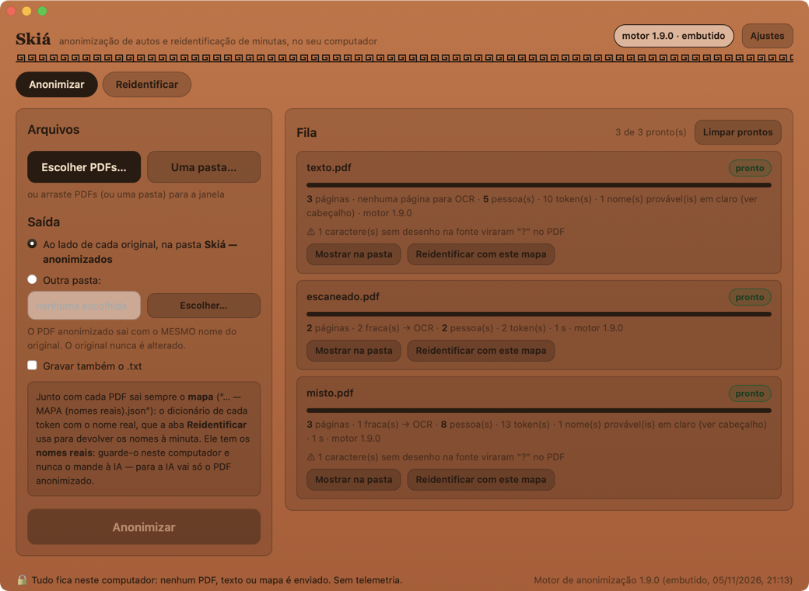
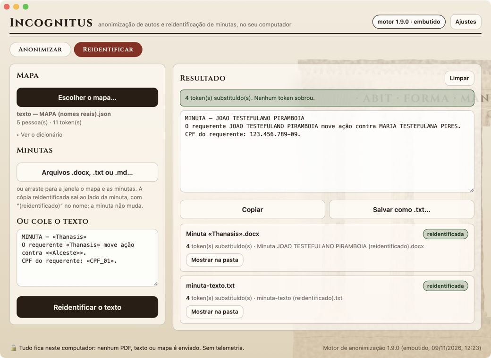

# Incognitus

*Incognitus: em latim, "não reconhecido". A pessoa continua nos autos, só não é reconhecida — o nome sai, a forma fica.*



Aplicativo de computador (Mac e Windows) que **anonimiza autos em PDF, em lote**, com o **mesmo motor de anonimização
do Graphé** — o mesmo fluxo do lote automático (preparar → classificador → concluir), as mesmas regras, o
mesmo cabeçalho de autos anonimizados — e **reidentifica as minutas** que a IA devolve, com o mapa de cada processo,
como o 🔓 do Graphé. **Tudo roda no computador**: nenhum PDF, texto ou mapa sai dele, e não há telemetria. As únicas
conexões são, ao abrir, a procura por versão nova do app e das regras (só leitura do GitHub público), que os Ajustes
desligam.


## Como usar

### Anonimizar

1. **Escolher arquivos…** (vários de uma vez), **Uma pasta…**, ou arrastar arquivos/pastas para a janela: **PDF** e,
   desde 14/11/2026, **Word (.docx)** e **texto (.txt)** — o relatório, o termo, a peça que vem junto com os autos.
2. **Saída**: por padrão, ao lado de cada original, na pasta **`Incognitus — anonimizados`**; ou outra pasta à escolha.
   A saída é sempre um PDF, com o **nome do original terminado em `_anon` e sem os nomes de pessoa** (14/11/2026):
   "relatorio - JOÃO DA SILVA.docx" sai "relatorio - «Thanasis»_anon.pdf", com o mesmo token do texto (o nome do
   arquivo também vai para a IA); o .txt, o mapa e a lista CONFIRA levam o mesmo nome.
   O original **nunca** é aberto para escrita: as ferramentas trabalham numa cópia temporária, e o Incognitus recusa
   gravar por cima dele.
3. Opcional: **Gravar também o .txt** (o mesmo texto do Graphé: cabeçalho + `===== PÁGINA n =====`).
4. **Anonimizar**. Primeiro lê cada arquivo, um por vez (extraindo, OCR x/y); depois junta os do mesmo caso e anonimiza
   e grava caso a caso; a fila mostra cada etapa (lido, anonimizando, gravando, pronto, erro).
   No máximo 2 OCRs ao mesmo tempo, com prioridade baixa. A pasta temporária de cada PDF é apagada ao fim dele.

5. **Juntar os documentos do mesmo caso** (ligado por padrão; 14/11/2026). Os arquivos da mesma leva que são do mesmo
   caso são anonimizados **juntos, com um mapa só**: a mesma pessoa leva o mesmo token em todos, e a minuta do caso
   volta com um mapa. O que liga dois documentos: o **número do processo** (no nome do arquivo ou na capa), um
   **documento de pessoa** em comum (CPF, RG, CNH, CNS, telefone, placa, e-mail) ou a **mesma pessoa** (um nome com
   três palavras ou mais, ou dois nomes em comum; autoridades ficam em claro e não ligam nada). Um nome de pessoa no
   nome do arquivo entra como parte do caso, como a linha do pedido no Graphé. A fila mostra o caso e o motivo;
   **Separar** e **Juntar a…** corrigem à mão, e os casos mexidos são refeitos (sem ler os arquivos de novo). Cada
   documento sai com as suas páginas (numeradas a partir de 1); o cabeçalho é o do caso, com a lista dos documentos.
   O mapa e a lista CONFIRA do caso vão com cada um.
6. Opcional: **Anonimização rigorosa** (14/11/2026). Depois das regras, um modelo de inteligência artificial lê o
   texto e aponta nomes e endereços que as regras deixaram passar (prenome solto, apelido, nome em minúscula, endereço
   sem "Rua"). **Fica mais lenta** — de 1 a 4 segundos por página — e, na primeira vez, baixa o modelo (110 MB). O
   modelo só aponta; quem decide é o motor: autoridade, advogado, servidor e precedente citado continuam em claro, e
   palavra comum ou que não é nome no léxico do IBGE é recusada. O que ele achou e o que foi recusado (com o motivo)
   vão para a lista CONFIRA.

**A saída**: os **autos anonimizados** ao lado do original, e o que tem nomes reais numa subpasta à parte,
**`NÃO ENVIAR À IA (nomes reais)`** (14/11/2026), para não ir junto por engano:

- O PDF tem a primeira folha para o cabeçalho de autos anonimizados (com a versão do motor) e **uma folha para cada
  página dos autos**, em fonte monoespaçada (DejaVu Sans Mono) de **11 pt** — a fonte nunca encolhe: a folha cresce
  quando a página tem linhas longas. O texto é selecionável (dá para copiar e mandar a uma IA).
- O mapa, `… — MAPA (nomes reais).json`, na subpasta, sai **sempre** (pedido do Promotor, 05/11/2026): o dicionário de cada token
  («Thanasis», «REU_01», «CPF_01»…) com o nome ou o dado real, no mesmo formato do mapa do Graphé. É ele que devolve
  os nomes na reidentificação. Tem os **nomes reais**: fica no computador e nunca vai à IA — para a IA vai só o PDF.
- A **lista CONFIRA**, `… — CONFIRA (nomes reais).txt`, também na subpasta (e no botão **Lista CONFIRA** da fila): o
  que olhar antes de mandar o PDF à IA — etapas do motor que falharam, páginas sem texto ou com pouco texto, páginas
  que passaram por OCR, candidatos a nome que ficaram em claro (com a página e o contexto), sobras da varredura e, no
  modo rigoroso, o que o modelo achou e o que o motor recusou.
- **Os carimbos do PJe** (pedido do Promotor, 09/11/2026) saem **sem quem assina e sem quem gerou o PDF**:
  "Assinado eletronicamente por: [omitido] - 05/11/2026 14:32:10", "Este documento foi gerado pelo usuário [omitido]
  em …"; o pedaço do carimbo que o pdftotext parte em linhas na diagonal some. Também os carimbos do SEI ("documento
  assinado eletronicamente por [omitido], Promotora de Justiça, …") e da assinatura ICP-Brasil (o CPF junto). Ficam a
  data, a hora, o número do documento e o "Num. … - Pág.", que a IA usa para citar o ID. No corpo dos autos vale a
  regra do Graphé: servidores, autoridades e advogados ficam em claro.

### Reidentificar

**No card do caso** (14/11/2026, pedido do Promotor): a minuta que a IA escreveu sobre os autos anonimizados volta aos
nomes ali mesmo, sem trocar de aba. Cada caso pronto tem o bloco **Minuta da IA**:
**Reidentificar minuta…** (.docx, .txt ou .md), **Colar texto** (uma janelinha com o resultado para copiar) ou arrastar
a minuta para o card. Vale o mapa daquele caso. Num caso com vários documentos, o bloco fica no primeiro card (o mapa é
um só). Arrastada para fora dos cards, a minuta .docx/.txt entra na fila para ser anonimizada, como antes.



A aba **Reidentificar** serve para o mapa de outro dia (a fila não guarda as levas antigas) e faz o que o 🔓 do Graphé
faz na minuta, com as mesmas funções do motor:

1. **Escolher o mapa…**. O mapa do Graphé também serve. O dicionário
   (token → nome) fica à vista em **Ver o dicionário**.
2. A minuta que a IA devolveu: **arquivos .docx, .txt ou .md** (ou arrastados para a janela, junto com o mapa), ou o
   texto **colado** na caixa.
3. Cada token do mapa volta a ser o nome — aceitando os delimitadores que a IA tenha trocado (`«»`, `<<>>`, `[[]]`,
   `{{}}`); o nome grego só é trocado com delimitador (um "Sócrates" solto pode ser o filósofo). O nome do arquivo
   também é reidentificado.
4. O **aviso** aponta o que sobrou: token fora do mapa, malformado ou que ficou. Confira esses pontos antes de usar.

O arquivo reidentificado sai **ao lado da minuta**, com `(reidentificado)` no nome; a minuta não muda. No .docx, a
troca é feita dentro de cada parágrafo (mesmo com o token partido em trechos de formatação diferentes, como o Word às
vezes grava), no corpo, nos cabeçalhos, nos rodapés, nas notas e nos comentários; o resto do arquivo sai igual. O texto
colado volta na tela, com **Copiar** e **Salvar como .txt…**.

**Ajustes**: os **contatos institucionais** que ficam em claro (um por linha; o padrão é o `ANON_INST_PADRAO` do
Graphé), a checagem das regras ao abrir, a versão do motor em uso, **Atualizar regras** e **Voltar à versão anterior**.

## Baixar

Página do app: **https://consciencia.eco.br/incognitus/**. Os instaladores têm endereço fixo, que baixa sempre a versão
mais recente:

- Mac (universal, macOS 13+): `https://consciencia.eco.br/incognitus/mac`
- Windows (64 bits): `https://consciencia.eco.br/incognitus/windows`

Esses endereços são funções da Cloudflare no portal (repositório `claudiogonzaga/consciencia`, `functions/incognitus/`)
que entregam o arquivo da release mais nova do GitHub: a **rede do MPMT bloqueia o github.com** ("Violação de Filtro
Web"), e o consciencia.eco.br abre. A seção Downloads de graphe.consciencia.eco.br aponta para os mesmos endereços. Fora
da rede do MPMT, os do GitHub também servem:

- `https://github.com/claudiogonzaga/incognitus/releases/latest/download/Incognitus-macOS.dmg`
- `https://github.com/claudiogonzaga/incognitus/releases/latest/download/Incognitus-Windows.msi`

Cada versão (tag `v*`) publica no GitHub uma release, a mais nova, com os instaladores nesse nome fixo; o portal passa a
entregá-la sozinho (guarda 10 minutos). O repositório é **público** desde 09/11/2026 (decisão do Promotor).

**Atualizar**: ao abrir (se ligado nos Ajustes) ou em **Ajustes → Procurar versão nova**, o app pergunta pela versão mais
nova, como o Comentora — primeiro ao portal (`consciencia.eco.br/incognitus/versao`, que lê o GitHub do lado da
Cloudflare), depois direto ao GitHub. Se houver, uma faixa no alto oferece **Atualizar agora**: baixa o instalador para a
pasta Downloads (se a conexão cair, tenta de novo e retoma de onde parou) e o abre — no Mac, arrasta-se o Incognitus para Aplicativos (Substituir); no Windows, o `.msi` troca a
versão instalada. As regras continuam com a atualização própria, assinada (ver "O motor").

## Como abrir (o app ainda não tem assinatura digital)

- **Mac**: abra o `.dmg`, arraste o Incognitus para Aplicativos. Na primeira vez, o macOS avisa que não pode verificar o
  desenvolvedor: clique em **OK**, abra **Ajustes do Sistema → Privacidade e Segurança**, role até "O Incognitus foi
  bloqueado…" e clique em **Abrir Mesmo Assim** (pede a senha). Se aparecer "está danificado", rode uma vez no Terminal:
  `xattr -dr com.apple.quarantine /Applications/Incognitus.app`.
- **Windows**: rode o `.msi`. Se o SmartScreen avisar "O Windows protegeu o computador", clique em **Mais informações →
  Executar assim mesmo**. (Se o navegador bloquear o download, escolha "Manter".)

## O motor (as regras)

`motor/motor.js` é gerado por **`scripts/extrair_motor.mjs`** a partir do `graphe.js` (pasta irmã `../Graphe`):

- tira **só** o que o app usa — as funções que o `testes/anon/pipeline.js` do Graphé chama, mais o cabeçalho do
  `anonConcluir`, a escolha das páginas para o OCR, a reidentificação do 🔓 (`_anonReidentificarTexto_`,
  `_anonReidTitulo_`, `_anonSobrasReid_`) e os carimbos do PJe na saída (`_anonSemCarimbosSaida_`) — e, **pelo nome**
  (nunca por número de linha), tudo de que elas dependem. O `pipeline.js` vai junto, sem alteração;
- **um motor só** (pedido do Promotor, 09/11/2026): toda regra mora no `graphe.js`, inclusive a dos carimbos (que lá
  não está ligada na saída do Graphé); o número do motor (`ANON_VERSAO`) é o mesmo nos dois, e no Graphé ele não manda
  refazer nada (o gatilho de refazer é a `ANON_VERSAO_REFAZER`);
- o que no Graphé vem da planilha e do Apps Script (VARIAVEIS_GLOBAIS, equipe, propriedades, Logger) é o
  `motor/fonte/ambiente.js`: equipe vazia, contatos institucionais pelos Ajustes. A API do app é `motor/fonte/api.js`
  (versão 2, a da reidentificação: o app só aceita motor da sua versão de API);
- os comentários saem (o motor vai para um repositório público e eles citam casos);
- **trava** (`scripts/trava.mjs`): o build **para** se o motor tiver ID de arquivo do Drive, URL de WebApp, ID de
  planilha, token ou chave, e-mail, prompt de IA, código do Apps Script ou nome de pessoa — e lista o que achou. Nomes
  só podem estar nas listas de palavras do motor (léxicos do IBGE, municípios, prenomes gregos), na lista de
  autoridades públicas que o motor deixa em claro (`ANON_LISTA_BRANCA_FIXA`) e nos contatos institucionais;
- **suíte** (`scripts/regressao_motor.cjs`): o `testes/anon/regressao.js` do Graphé (63 casos fictícios), **sem
  alteração**, rodando sobre o `motor.js` num contexto limpo, sem nada do Apps Script; depois os mesmos casos pela
  API do Incognitus — cada um com a **volta**: os autos anonimizados, reidentificados com o próprio mapa, não podem guardar
  token nem sobra —, a paridade caso a caso com o `pipeline.js` e os testes dos carimbos na saída. Só aceita o motor
  com **"0 falhas"** em tudo (94 casos em 09/11/2026).

```bash
node scripts/extrair_motor.mjs            # monta motor/ e o motor embutido no app (modulo/motor/)
node scripts/regressao_motor.cjs          # só a suíte
```

### Atualização das regras pelo GitHub

O app baixa as regras de um repositório **público** só com o motor (`claudiogonzaga/incognitus-motor`, ainda **não
criado** — ver Pendências): `motor.js`, `manifesto.json` (versão = `ANON_VERSAO`, data, sha256) e
`manifesto.json.sig` (Ed25519). Ao abrir (se ligado nos Ajustes) e no botão **Atualizar regras**: baixa o manifesto,
**confere a assinatura** com a chave pública embutida no app (`motor/chave_publica.txt`), compara a versão, baixa o
`motor.js`, **confere o sha256**, **roda os 63 casos embutidos** num worker à parte e só então troca. A versão
anterior fica guardada (**Voltar à versão anterior**). Assinatura adulterada, sha256 errado ou caso falhando: nada muda.

```bash
scripts/publicar_motor.sh                 # extrai → suíte → casos do app → assina → commit + tag + release
scripts/publicar_motor.sh --sem-publicar  # tudo menos a publicação
```

A chave privada fica em `_segredo/motor_ed25519.pem` (fora do git, permissão 600, nunca impressa). **Faça uma cópia de
segurança dela**: sem ela, só um app novo (com outra chave pública) aceitaria regras novas.

## As ferramentas embutidas (sidecars)

`pdftotext` e `pdftoppm` (poppler) e `tesseract` com o modelo `por`, chamados **como o serviço do Graphé**
(`cloudrun-pdftotext/main.py`): `pdftotext -layout arquivo -` (um `\f` por página); páginas fracas pelo critério do
Graphé (`_pdfPaginasFracas_`); cada uma, `pdftoppm -r 200 -gray` + `tesseract -l por`; o texto do OCR só entra se tiver
mais texto útil (critério do serviço, com a semântica do Python: quebras de linha, `\d`/`\s` Unicode, `rstrip`).

Versões, para bater com o serviço (que roda em `python:3.11-slim`, Debian 13): **poppler 25.02.0** (o mais próximo do
25.03 do Debian publicado no conda-forge), **tesseract 5.5.0** e o `por.traineddata` do **tessdata_fast 4.1.0** — o
mesmo arquivo do pacote `tesseract-ocr-por` do Debian (sha256 `c4932b93…`, conferido).

```bash
python3 scripts/sidecars.py mac        # Mac: arm64 + x86_64 → universais (conda-forge via micromamba)
python scripts/sidecars.py windows     # Windows x64 (pip install pefile)
```

Licenças: o poppler é **GPL**; o tesseract, Apache-2.0. Os textos das licenças de todos os pacotes embutidos, as
versões e onde está o código-fonte vão dentro do app (`LICENCAS-terceiros/LEIA-ME.txt`). O workflow anexa o código-fonte
do poppler aos instaladores. A fonte do PDF é a DejaVu Sans Mono (licença livre, `plugin/recursos/fontes/LICENSE_DEJAVU`).

**A anonimização rigorosa** usa o modelo **inples-tech/anonimato-ner-ptbr** (Apache-2.0; BERT em português, int8,
rótulos PESSOA, ORG, LOCAL e ENDERECO), numa revisão fixa do Hugging Face e conferido por sha256
(`plugin/src/ner.rs`). Não vai no instalador: o app baixa na primeira vez que a opção é ligada, para a pasta de dados
dele. Roda na própria janela, com o **onnxruntime-web** 1.31.1 (MIT, `modulo/vendor/onnxruntime-web/`), em alguns
Web Workers em paralelo (`modulo/ner_worker.mjs`); o tokenizador WordPiece é nosso (`modulo/ner.js`) e bate com o
original. Nada sai do computador, além do download do modelo. Nos testes, `SKIA_NER_DIR` aponta uma pasta com o
`model.onnx` e o `tokenizer.json`; sem ela, a seção do modo rigoroso do `testes/e2e.py` é pulada. O CI baixa o modelo
(com cache) e roda essa seção no Mac e no Windows.

**A logo** (14/11/2026): uma placa de travertino gravada INCO · GNI · TUS, com uma faixa de sombra sobre o GNI
(`scripts/icone/logo-pedra-original.jpeg` → `icone.png` → `npx tauri icon`); a janela seguiu a placa: tons de pedra,
tinta escura, títulos gravados e a régua como a faixa de sombra. **O tema** (09/11/2026, romano): travertino, tinta sépia e vermelho pompeiano; os títulos na **Cinzel**, as capitais das
inscrições romanas (SIL Open Font License, `modulo/fontes/OFL-Cinzel.txt`; a Trajan, que inspirou o pedido, é paga e não
pode ir dentro do app); ao fundo, as colunas do Fórum em aquarela com a inscrição NOMEN · ABIT · FORMA · MANET ("o nome
sai, a forma fica") e o NOMEN raspado a cinzel, como na *damnatio memoriae*, com uma sombra caindo sobre ele
(`scripts/fundo/gerar_fundo.py` → `modulo/fundo.webp`).

## Desenvolvimento

```bash
npm ci
python3 scripts/sidecars.py mac                              # uma vez (fica em .ferramentas/, fora do git)
npx tauri dev                                                # o app
npx tauri build --target universal-apple-darwin --bundles dmg
cargo test --manifest-path src-tauri/Cargo.toml -p incognitus -p tauri-plugin-anonimizacao   # PDF, assinatura, versões, .docx, e a janela falando com o plugin
python3 testes/e2e.py                                        # ponta a ponta (depois de: npx tauri build --debug --no-bundle)
SKIA_E2E_SO=casos python3 testes/e2e.py                      # só a seção 7 (vários documentos do mesmo caso); =rigoroso, só a 6
python3 scripts/icone/gerar_icone.py && npx tauri icon scripts/icone/icone.png   # o ícone (depois: rm -r src-tauri/icons/{android,ios})
```

O **teste de ponta a ponta** gera 3 PDFs **fictícios** (texto, escaneado, misto), roda o app de verdade (modo de teste,
`SKIA_E2E`, com dados e cache à parte) e confere: nomes de saída = os de entrada com `_anon`, nenhum dado de pessoa fictícia
em claro, originais intactos, uma folha por página + cabeçalho, 11 pt, o mapa ao lado; a **reidentificação** com o mapa
que o app gravou (texto colado, minuta .txt e .docx com um token partido em dois trechos de formatação, no corpo, no
cabeçalho e no nome do arquivo); a atualização assinada das regras (e a recusa da adulterada); e a **extração idêntica,
byte a byte, à do `main.py` do serviço** rodando localmente com as mesmas ferramentas. Com `SKIA_NER_DIR`, a
**anonimização rigorosa** (seção 6); e sempre um **caso com vários documentos** (seção 7: PDF, .docx com o nome da
pessoa no título e .txt do mesmo caso, mais um PDF de outro caso — um mapa só, nome do arquivo sem nomes, Separar).

O app de teste divide a identidade com o Incognitus instalado: com ele aberto, o teste para. Para não fechar o
instalado, monte o de teste com outra identidade e avise o teste:
`npx tauri build --debug --no-bundle --config '{"identifier":"br.eco.consciencia.incognitus.teste"}'` e
`SKIA_E2E_OUTRA_IDENTIDADE=1 python3 testes/e2e.py`.

**Build e entrega**: `.github/workflows/build.yml` (Actions → build → Run workflow, ou tag `v*`): macOS universal (`.dmg`)
e Windows x64 (`.msi`), como artefatos; com tag, também numa Release em rascunho.

Nunca use dados reais de processos em testes, exemplos, commits ou logs.

## Módulo do Graphé Desktop

O Incognitus segue o contrato de módulo do Graphé Desktop (`MODULOS.md`, no repositório dele): o mesmo código serve ao
app avulso e ao Graphé Desktop, que o hospeda como mini-app.

**A página não pode dormir** (14/11/2026). No Mac, com a janela fora da tela (outra mesa, app em tela cheia,
minimizada), o WebKit freia os timers e, depois de uns 5 minutos, suspende a página inteira: o motor e a leitura
rigorosa congelavam no meio, sem CPU, até a janela voltar. O plugin resolve isso para toda janela do app, também a do
hospedeiro (`on_webview_ready` → `plugin/src/acordado.rs`): desliga no WKWebView a supressão de processo pela
visibilidade e o freio dos timers de página escondida, põe a política de página inativa em "nenhuma" e desliga a
detecção de oclusão (as três primeiras são preferências do WebKit; só são chamadas se existirem). Enquanto a fila roda, o
app também declara ao macOS uma atividade iniciada pelo usuário (`plugin:anonimizacao|acordado`), que impede o repouso
automático do Mac no meio de um lote; no Windows, uma Web Lock segura a página. A janela do app avulso tem ainda
`"backgroundThrottling": "disabled"`.

- **`plugin/`**: o crate `tauri-plugin-anonimizacao`. `init()` é o app avulso (dados na raiz da pasta de dados do app,
  como sempre); `init_como_modulo()` é o hospedado (dados em `<dados do hospedeiro>/modulos/incognitus/`, cache em
  `<cache>/modulos/incognitus/`). O comando `info` diz qual dos dois. As permissões: `anonimizacao:default` (a janela
  do Incognitus) e `anonimizacao:api` (o que o hospedeiro chama da janela principal dele para ler os autos:
  `info`, `preparar_arquivo`, `extrair_texto`, `ocr_pagina`, `limpar_arquivo` e `motor_ativo`).
- **`modulo/`**: a janela, copiada como está, e o `modulo.json` (id `incognitus`, sidecars, recursos nos mesmos
  caminhos do app avulso, e os arquivos do motor embutido que o hospedeiro pode carregar). Hospedada, a janela esconde
  a atualização do app; a atualização assinada das regras vale nos dois modos.
- **`src-tauri/`**: o app avulso, que é o plugin mais a janela, com a atualização do próprio app.

A versão do `modulo.json`, a do `plugin/Cargo.toml` e a do app (`src-tauri/Cargo.toml`) andam juntas, com a do
`tauri.conf.json` e a do `package.json`, como antes; um teste do plugin e um do app param se as três primeiras divergirem.

## Pendências (09/11/2026)

- **Regras que atualizam sem reinstalar**: o repositório público só das regras (`claudiogonzaga/incognitus-motor`) não
  foi criado. As regras já estão públicas, no repositório do app, e hoje chegam com a versão nova dele (botão Atualizar).
  Para as regras atualizarem sozinhas, entre uma versão e outra do app: `gh repo create claudiogonzaga/incognitus-motor
  --public` e `scripts/publicar_motor.sh` (pede a confirmação do Promotor).
- **Assinatura digital**: sem Developer ID da Apple nem certificado de código para Windows, ficam os avisos do Gatekeeper
  e do SmartScreen (ver "Como abrir"). Ao assinar e notarizar no Mac, religar o *hardened runtime* exige também assinar
  as dylibs dos sidecars com a mesma equipe (ou o direito `com.apple.security.cs.disable-library-validation`).
- **Licença** do próprio Incognitus e do motor publicado: não definida.
- **Bateria com autos reais** (09/11/2026, pedido do Promotor; tudo no computador, na pasta temporária da sessão, apagado
  no fim; nada real em teste, commit ou log). Rodadas: 5 autos de Downloads, 10 casos da φ.26 (os de mais erros na coluna
  ERROS_ANONIMIZACAO) e 2 lotes de 5 autos inéditos; cada padrão de vazamento foi para o `graphe.js`, com exemplo
  fictício, e voltou por extração (d749ec4 → 10b1120: a suíte foi de 69 a 104 casos). Os maiores: o **prenome sozinho**
  de quem tem token na prosa (um réu ficava 31 vezes em claro); a parte com patente ou função antes do nome; o
  formulário pontilhado; o cabeçalho de termo e o andamento do PJe com o prenome; a filiação partida em colunas; a
  página escaneada do e-SAJ que não ia ao OCR (47 páginas sumiam sem aviso). Na camada do Incognitus: os carimbos
  ICP-Brasil em várias linhas, na diagonal e estropiados pelo OCR (hoje no `graphe.js`, `_anonSemCarimbosSaida_`).
  **Prova final**: um lote de 5 autos inéditos (339 páginas), guardado sem olhar até o motor final, saiu **sem nome de
  parte, vítima ou testemunha em claro** — o que sobra em claro é autoridade (regra 4), lugar e precedente citado (que
  não se mascara, decisão do Promotor). Ficaram para a versão seguinte: o endereço partido pela quebra de linha depois
  do "n.°" e o carimbo com o "eletronicamente" cortado; e o motor não tem como pegar o prenome de quem nunca aparece
  com o nome inteiro (ex.: "as amigas FULANA e BELTRANA").
- **Nome**: o app se chamava Skiá até a 0.2.0; o repositório virou `claudiogonzaga/incognitus` em 09/11/2026 (o nome
  antigo redireciona). A pasta (`CODIGO/Skia`), as variáveis de teste (`SKIA_E2E`, `SKIA_DADOS`…) e a API do motor
  (`SkiaMotor`) ficaram com o nome antigo, de propósito (são internas).
- **Ícone** (06/11/2026, a pedido do Promotor): uma mão grega faz sombra sobre a inscrição de uma coluna jônica, e a
  sombra esconde o meio das linhas; moldura de meandro do Phylax. Gerado por `scripts/icone/gerar_icone.py` (SVG → PNG
  pelo `rsvg-convert`).
- No Windows, o teste de ponta a ponta roda no CI (instalando o `.msi`); a instalação de um motor assinado só é testada
  onde está a chave privada (aqui), lá só a recusa de assinatura inválida.

## Estrutura

```
motor/            motor.js (gerado), manifesto + assinatura, casos.json, chave_publica.txt; fonte/: ambiente.js e api.js
modulo/           a janela (HTML/JS/CSS simples), worker.js (o motor no Web Worker), casos.js, motor/ (o embutido) e o
                  modulo.json (o contrato de módulo do Graphé Desktop)
plugin/           o crate tauri-plugin-anonimizacao (comandos `plugin:anonimizacao|…`): sidecars (ferramentas.rs), PDF de
                  saída (pdf.rs), motor e atualização dele (motor.rs), minutas da reidentificação: .txt e .docx
                  (reid.rs), comandos (lib.rs), permissões (permissions/default.toml: os conjuntos default e api)
src-tauri/        o app avulso: o plugin com init(), a janela main em ../modulo, ícones, instalador e a atualização do
                  app (atualizar.rs)
scripts/          extrair_motor.mjs, trava.mjs, regressao_motor.cjs, assinar_motor.mjs, publicar_motor.sh, sidecars.py,
                  montar.mjs (o `montar` do modulo.json), icone/gerar_icone.py
testes/           gerar_pdfs.py (PDFs fictícios) e e2e.py
_segredo/         a chave privada do motor (fora do git)
```
